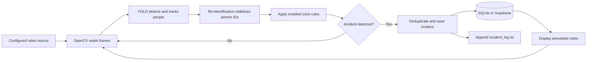
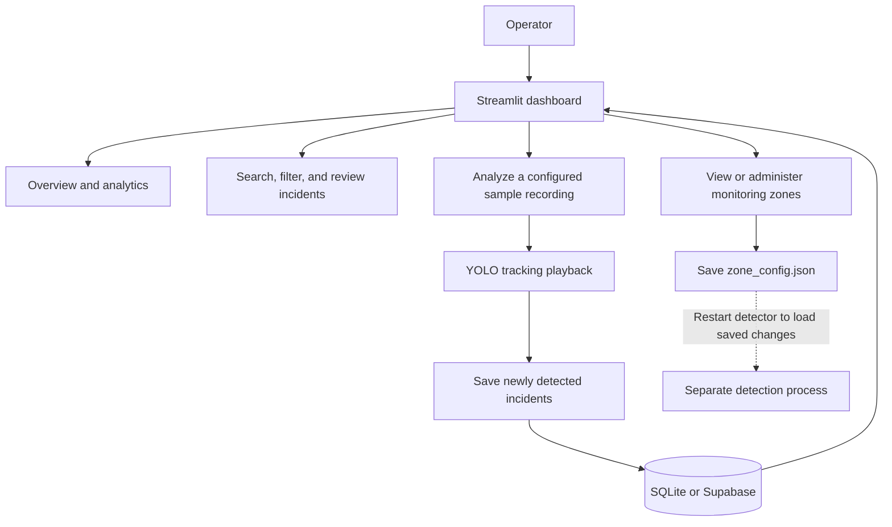

# Campus Security Monitoring

A computer-vision prototype for analyzing recorded campus-camera footage, flagging activity in configurable monitoring zones, and reviewing incident records in a Streamlit dashboard.

> **Prototype notice:** The configured source is a sample video, not a connected live CCTV feed. The detector and dashboard run as separate processes. This project is not a substitute for human review or a production security system.

## What it does

- Detects and tracks people in video with Ultralytics YOLO.
- Applies configurable zone rules for restricted-area entry, crowd thresholds, loitering, and after-hours movement.
- Attempts to keep person identifiers stable across tracker ID changes.
- Saves incident records locally to SQLite, or to Supabase PostgreSQL when configured. Repeated matching events are deduplicated.
- Provides a Streamlit dashboard for incident review, analytics, recorded-video playback, and zone configuration.

## Workflows

### Detection and incident logging



### Dashboard and review



The dashboard does not start the detector or connect to a live camera. Its **Refresh incident data** control clears the dashboard's short-lived cache and reloads records; it does not change incident data. Running fresh tracking is different: it analyzes the sample recording and can add newly detected incidents.

## Quick start

Python 3.10 or later is required. The dashboard and detector can be run independently.

### 1. Run the dashboard

From the repository root in PowerShell:

```powershell
py -3.10 -m venv .venv-dashboard
.\.venv-dashboard\Scripts\Activate.ps1
python -m pip install --upgrade pip
python -m pip install -r dashboard/requirements.txt
python -m streamlit run dashboard/app.py
```

The dashboard uses the local `incidents.db` by default and creates its incident table when needed. The repository includes a sample recording for playback.

### 2. Run the standalone detector (optional)

Use a separate environment so the detector's desktop video window does not conflict with the dashboard's headless OpenCV dependency:

```powershell
py -3.10 -m venv .venv-detector
.\.venv-detector\Scripts\Activate.ps1
python -m pip install --upgrade pip
python -m pip install ultralytics opencv-python lap
python main.py
```

The detector opens the configured source in an OpenCV window. Press **Q** to quit. Update the camera source and settings in [`cameras.py`](./cameras.py) before using different footage or a camera. The currently active configuration points to `sample_videos/campus.avi`.

## Configuration and storage

### Monitoring zones

Default camera and zone settings are defined in [`cameras.py`](./cameras.py) and [`zones.py`](./zones.py). Each zone can enable one or more rules:

| Rule | Behavior |
| --- | --- |
| Restricted | Record a restricted-zone intrusion |
| Crowd | Record when the number of people exceeds the zone threshold |
| Loitering | Record when a tracked person remains beyond the configured duration |
| After-hours | Record movement outside the camera's permitted hours |

The dashboard's **Camera & Zone Management** page is read-only unless `CAMPUS_SECURITY_ADMIN_PASSWORD` is set before launching Streamlit. Changes are saved to `dashboard/zone_config.json`; restart the separately running detector to load them. This password is a simple shared-secret gate, not user accounts or campus identity management.

### Incident database

- **Local:** `incidents.db` (SQLite), created as needed.
- **Hosted:** Set `SUPABASE_DB_URL` to a PostgreSQL connection URI to use Supabase. The dashboard can also read this value from Streamlit secrets.
- **Text log:** The detector appends a human-readable record to `incident_log.txt`.

For Streamlit Community Cloud, the repository-root [`packages.txt`](./packages.txt) lists the required system packages. Add `SUPABASE_DB_URL` under the app's secrets settings for persistent hosted storage. The dashboard does not import local incident history into Supabase. Keep database URLs, admin passwords, camera footage, and incident data private; never commit credentials.

For detailed dashboard behavior, deployment notes, and data limitations, see [`dashboard/README.md`](./dashboard/README.md).

## Project layout

```text
.
├── main.py                 # Standalone detector and video window
├── cameras.py              # Active camera and model configuration
├── zones.py                # Zone rules, validation, and persistence
├── loitering.py            # Loitering tracking logic
├── reidentifier.py         # Person-ID stabilization
├── db.py                   # Incident logging and deduplication
├── dashboard/
│   ├── app.py              # Streamlit entry point
│   ├── database.py         # Incident reads and review updates
│   ├── storage.py          # SQLite / PostgreSQL storage
│   └── views/              # Dashboard pages
└── sample_videos/
    └── campus.avi          # Configured demonstration recording
```
